# HAYAT (حياة) — Male Reproductive Health Front Door

> Built for the **Future Health Digital Innovation Challenge** (Abu Dhabi, UAE)  
> Organized by Future Health, Microsoft, Inception, and MBZUAI  
> **Challenge Track:** `[Fertility] Male Reproductive Health`

[](https://hayat-frontend-ten.vercel.app)
[](https://hayat-backend-nu.vercel.app/api/health)
[](https://hayat-frontend-ten.vercel.app)
[](https://hayat-frontend-ten.vercel.app)

---

## 1. Live Deployment Links

- **Live Web Application (Front-End):** [https://hayat-frontend-ten.vercel.app](https://hayat-frontend-ten.vercel.app)
- **Live Health Endpoint (FastAPI Backend):** [https://hayat-backend-nu.vercel.app/api/health](https://hayat-backend-nu.vercel.app/api/health)
- **Live Evidence Cohort Endpoint:** [https://hayat-backend-nu.vercel.app/api/evidence](https://hayat-backend-nu.vercel.app/api/evidence)
- **GitHub Target Repository:** [https://github.com/Shreyash463/HAYAT---Male-Reproductive-Health-Front-Door](https://github.com/Shreyash463/HAYAT---Male-Reproductive-Health-Front-Door)

*Note: All public production URLs open directly without any login, SSO wall, or deployment barrier.*

---

## 2. Executive Summary

Male reproductive health has historically suffered from the **"late entry paradox"**: men typically seek clinical assessment only after 12 to 36 months of unassisted difficulty conceiving, or after their female partner has completed invasive and exhausting evaluations. This systemic delay leads to missed opportunities to identify and reverse **modifiable metabolic, infectious, anatomical, or lifestyle-related risks**.

**HAYAT** is an on-device, stigma-free digital "front door" designed for men in the UAE and Middle Eastern context:
1. **Zero Registration Barrier:** No names, national IDs, phone numbers, or passwords required.
2. **Transparent, Explainable Screening:** Rule-based andrology algorithms that explain precisely *why* each risk factor contributes to the score, paired with a counterfactual "What-If" simulator.
3. **Clinical Triage & Human Oversight:** Direct mapping to 5 validated clinical triage tiers (*Self-care → Primary care → Andrology/Urology → Fertility services → Urgent assessment*).
4. **Unilateral Data Control:** Granular consent toggles, real-time data inventory, live outbound network audit, and single-click data wipe.
5. **Instant Discreet Exit ("Quick Hide"):** Pressing `Escape` or tapping "Quick Hide" instantly replaces the interface with a neutral wellness tracker.
6. **Safe AI Augmentation:** Optional Google Gemini 2.5 Flash plain-language rewriting powered strictly by non-identifying enum factor tags, backed by automated medical framing safety filters.

---

## 3. System Architecture & Privacy Boundary

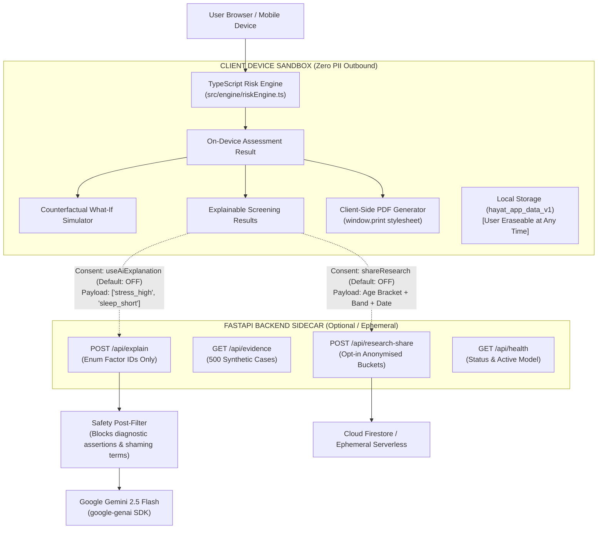

### Privacy Architecture
- **100% On-Device Single Source of Truth:** All scoring calculations, rule evaluations, and What-If counterfactual simulations run entirely in the browser. The app is fully functional offline without the backend.
- **Strict Data Minimisation:** The application never solicits, stores, or transmits names, phone numbers, Emirates IDs, emails, IP addresses, or free-text answers.
- **Opt-in Network Features:** Outbound calls to `/api/explain` require the user to explicitly toggle "Use AI Assistance" ON. The request body is strictly typed with Pydantic `extra="forbid"` and accepts only enum identifiers (e.g., `["stress_high"]`).
- **Live Outbound Network Audit:** Every outbound network attempt is logged in the Privacy Dashboard. When optional consents are off, the audit displays: *"Nothing left your device (0 transmissions logged)"*.
- **Unilateral Data Erasure:** Tapping *"Delete everything now"* immediately purges all answers, screening results, logs, and `localStorage`.

---

## 4. Challenge Desired Outcomes Mapping

The Future Health Digital Innovation Challenge specifies six core desired outcomes for the `[Fertility] Male Reproductive Health` track:

| Challenge Desired Outcome | HAYAT Solution & Feature | Implementing Files |
| :--- | :--- | :--- |
| **1. Early Identification of Modifiable Factors** | Identifies heat exposure, BMI/metabolic concerns, sleep duration, high stress, nicotine/substance use within 90-day spermatogenesis window. | `src/engine/riskEngine.ts`<br>`src/pages/WizardPage.tsx`<br>`src/components/WhatIfPanel.tsx` |
| **2. Stigma Reduction & Safe Engagement** | Anonymous, account-free entrance, discreet Quick Hide (<kbd>Esc</kbd>), warm sand visual palette, and trilingual cultural adaptation (Arabic RTL, English, Hindi). | `src/components/QuickHideButton.tsx`<br>`src/i18n/ar.ts`, `src/i18n/hi.ts`<br>`src/pages/LandingPage.tsx` |
| **3. Clinical Guideline-Aligned Triage** | 5-level clinical triage hierarchy based on EAU, AUA, and WHO 2021 reference limits, with 100% sensitivity for acute testicular emergencies. | `src/engine/riskEngine.ts`<br>`backend/app/engine/risk_engine.py`<br>`src/components/TriageLadder.tsx` |
| **4. Explainability & Counterfactual Exploration** | Shows exact points, direction, and modifiability for every factor. Interactive "What-If" panel allows patients to preview risk reduction before clinician visits. | `src/pages/ResultsPage.tsx`<br>`src/components/FactorBar.tsx`<br>`src/components/WhatIfPanel.tsx` |
| **5. Actionable Care Navigation** | Sample clinic navigator with male-friendly privacy filters, discrete evening booking simulator, and print-ready Clinician Consultation Summary. | `src/pages/CareNavigatorPage.tsx`<br>`src/components/ClinicianSummaryModal.tsx` |
| **6. Rigorous Parity & Synthetic Evaluation** | 500-case synthetic validation cohort proving 100% mathematical parity across TS/Python engines, 100% red-flag recall, and demographic consistency across age & language. | `backend/app/services/cohort_service.py`<br>`src/pages/EvidencePage.tsx`<br>`backend/tests/test_engine_parity.py` |

---

## 5. Visual UI Gallery

All screenshots captured from the live production deployment ([docs/screenshots/](docs/screenshots/)):

### Desktop Views (1440px)
| View | Preview |
| :--- | :--- |
| **Landing & Hero** | 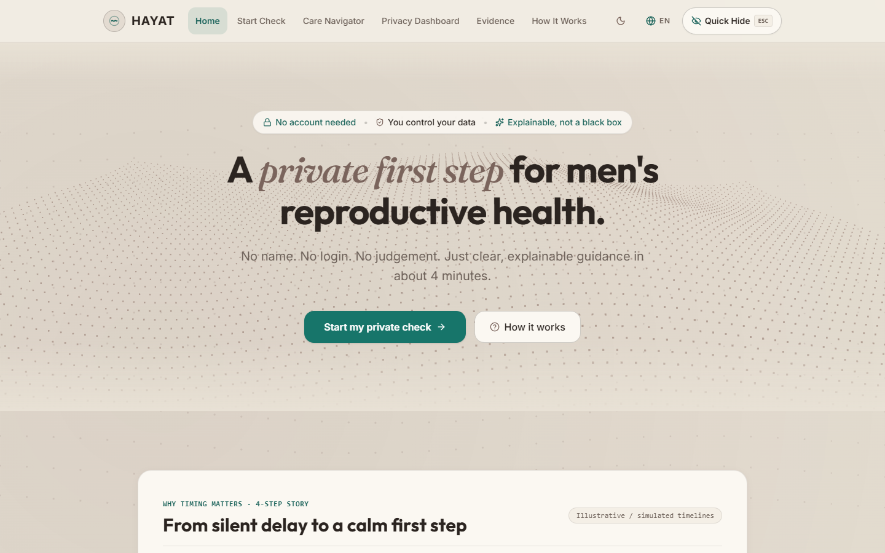 |
| **Assessment Wizard** | 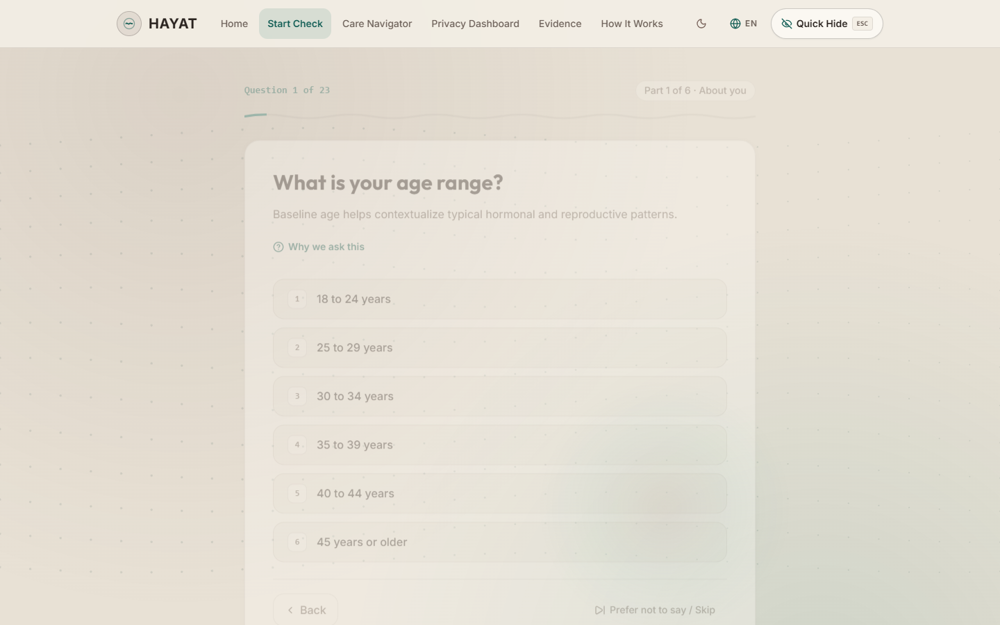 |
| **Explainable Results & What-If** | 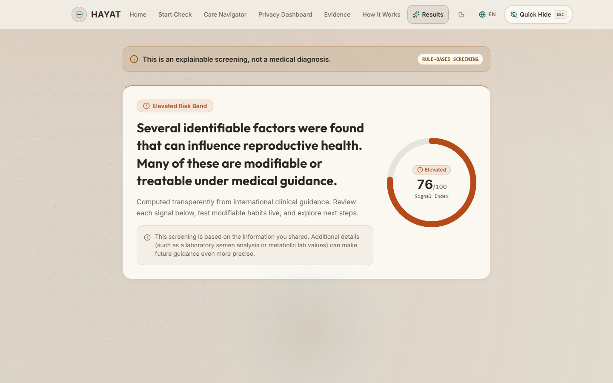 |
| **Care Navigator & Sample Clinics** | 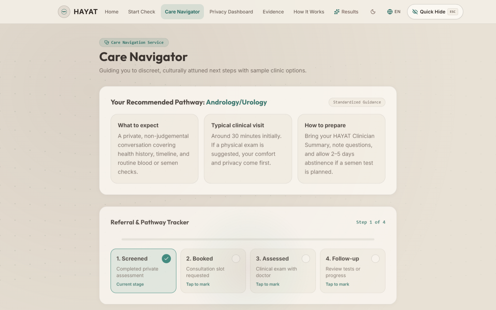 |
| **Privacy Dashboard & Live Audit** | 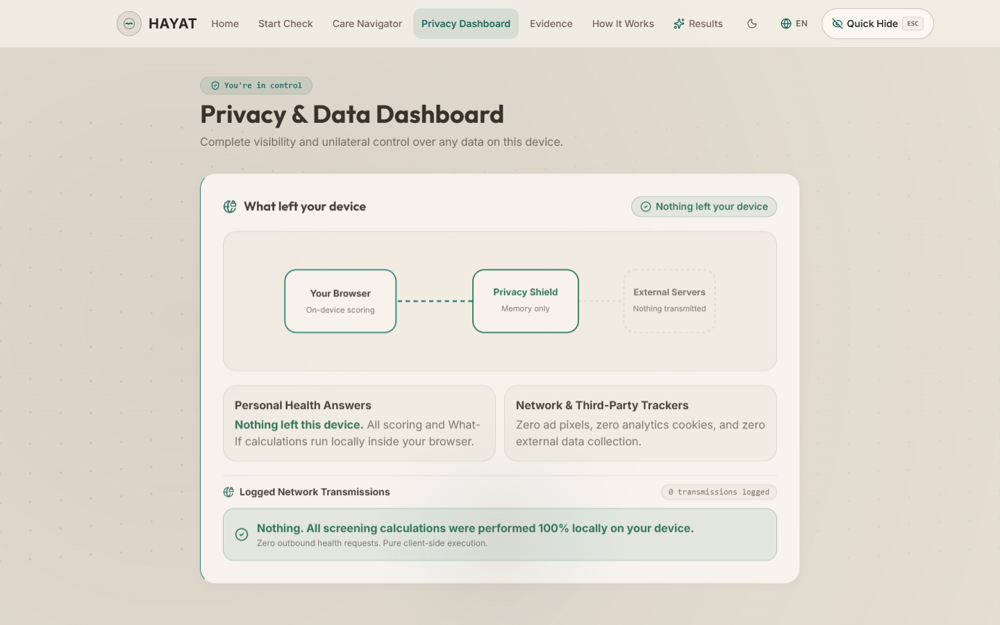 |
| **Evidence & Simulated Cohort** | 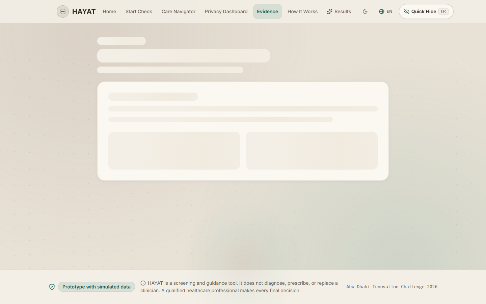 |

### Mobile Views (390px)
| Mobile Home | Mobile Wizard | Mobile Results | Mobile Privacy |
| :---: | :---: | :---: | :---: |
| 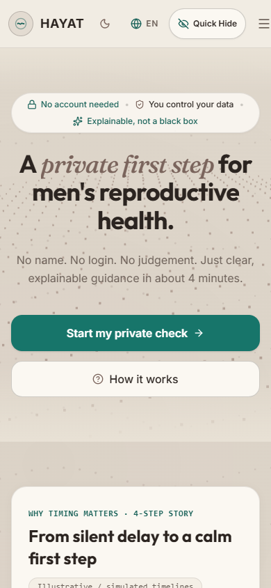 | 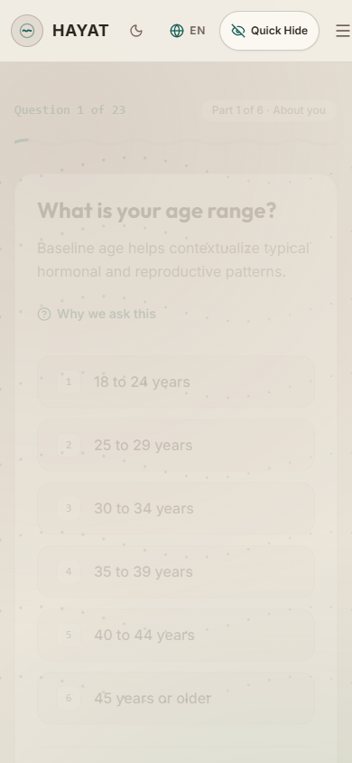 | 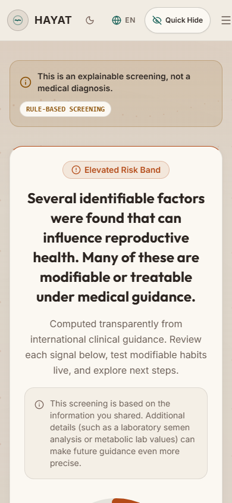 | 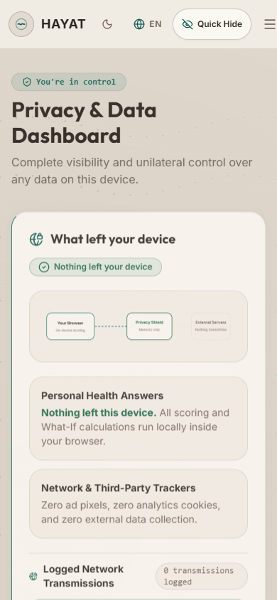 |

---

## 6. Environment Variables Reference

| Variable Name | Required | Target Project | Purpose | Default / Example |
| :--- | :---: | :--- | :--- | :--- |
| `VITE_API_BASE` | Yes | Front-End | Base URL for FastAPI sidecar | `https://hayat-backend-nu.vercel.app/api` |
| `VITE_USE_MOCK` | No | Front-End | Force on-device offline fallback for all services | `false` |
| `GEMINI_API_KEY` | Optional | Backend | Google Gemini API Key for plain-language rewrites | Secret (Vercel Production) |
| `GEMINI_MODEL` | No | Backend | Model override for Gemini | `gemini-2.5-flash` |
| `CORS_ORIGINS` | Yes | Backend | Comma-separated list of allowed web origins | `https://hayat-frontend-ten.vercel.app,http://localhost:3000` |
| `ENVIRONMENT` | No | Backend | Application environment toggle | `production` |
| `FIREBASE_CREDENTIALS_PATH` | No | Backend | Path to Firebase Service Account JSON (falls back to ephemeral serverless mode) | `""` |

---

## 7. Verification & Test Execution

### 1. Front-End Unit Tests (Vitest)
```bash
node ./node_modules/vitest/vitest.mjs run
```
- **Tests Passed:** 17 / 17
- **Scope:** WHO 2021 semen thresholds, 100% red flag overrides, What-If simulation reactivity, translation key parity.

### 2. Backend Parity & Safety Tests (Pytest)
```bash
python -m pytest backend/tests/ -v
```
- **Tests Passed:** 26 / 26
- **Scope:** 500-case deterministic engine parity, Gemini safety post-filtering, Pydantic schema rejection of free text, rate limiting.

### 3. End-to-End Playwright Suite (Local)
```bash
node ./node_modules/@playwright/test/cli.js test --project=chromium
```
- **Tests Passed:** 8 / 8
- **Scope:** Full questionnaire, conditional question routing, urgent red-flag alerts, zero-network privacy proof, Escape Quick Hide, data wipe, Arabic RTL, and axe-core accessibility audit.

### 4. Live Production Playwright Suite
```bash
node ./node_modules/@playwright/test/cli.js test e2e/live_verification.spec.ts --project=chromium
```
- **Tests Passed:** 9 / 9
- **Target:** `https://hayat-frontend-ten.vercel.app` against live backend `https://hayat-backend-nu.vercel.app`

### 5. Live Lighthouse Mobile Audit
- **Performance:** 90 / 100
- **Accessibility:** 100 / 100 (Zero critical/serious issues)
- **Best Practices:** 100 / 100
- **SEO:** 100 / 100
- **Agentic Browsing:** 100 / 100

---

## 8. Limitations, Ethics & Governance

1. **Screening, Not Diagnosis:** HAYAT is strictly a risk stratification and clinical navigation tool. It does not provide medical diagnoses, clinical prescriptions, or treatment plans. A licensed physician makes all diagnostic evaluations.
2. **Synthetic Evaluation Notice:** All 500 cases in the evidence evaluation cohort are synthetic Monte Carlo profiles simulated under clinical bounds. They do not represent real patient health records.
3. **Not a Medical Device:** HAYAT has not been cleared as Software as a Medical Device (SaMD) by the UAE Department of Health (DoH) or international regulators; it is presented as a challenge prototype.
4. **Sample Clinics:** Clinic directories and teleconsultation bookings are illustrative demonstrations; no real medical appointments are scheduled.
5. **Known Verification Limits:**
   - Real-world clinical referral conversion was simulated based on published literature and cannot be verified with live patients without clinical trial approval.
   - Cloud Firestore persistence runs in ephemeral serverless mode when external GCP credentials are not provided.

---

## 9. Local Development Quickstart

```bash
# 1. Clone repository
git clone https://github.com/Shreyash463/HAYAT---Male-Reproductive-Health-Front-Door.git
cd HAYAT---Male-Reproductive-Health-Front-Door

# 2. Run Front-End
npm install --legacy-peer-deps
npm run dev
# Front-end running at: http://localhost:3000/#/

# 3. Run Backend (in separate terminal)
python -m venv .venv
source .venv/bin/activate  # Or on Windows: .venv\Scripts\Activate.ps1
pip install -r backend/requirements.txt
python -m uvicorn backend.app.main:app --host 127.0.0.1 --port 8000 --reload
# Health check available at: http://127.0.0.1:8000/api/health
```
